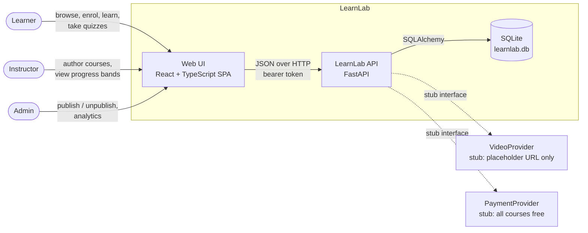
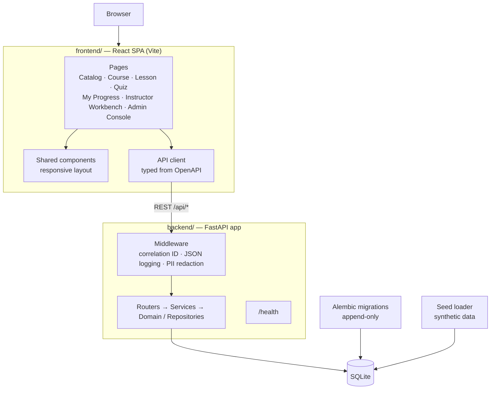
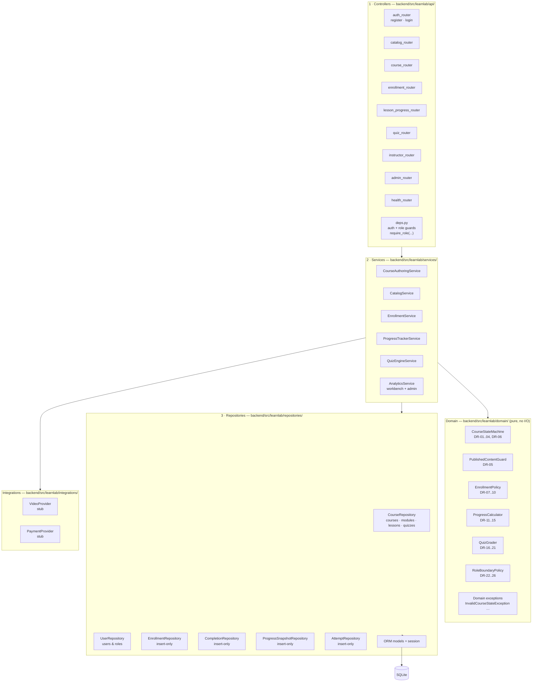
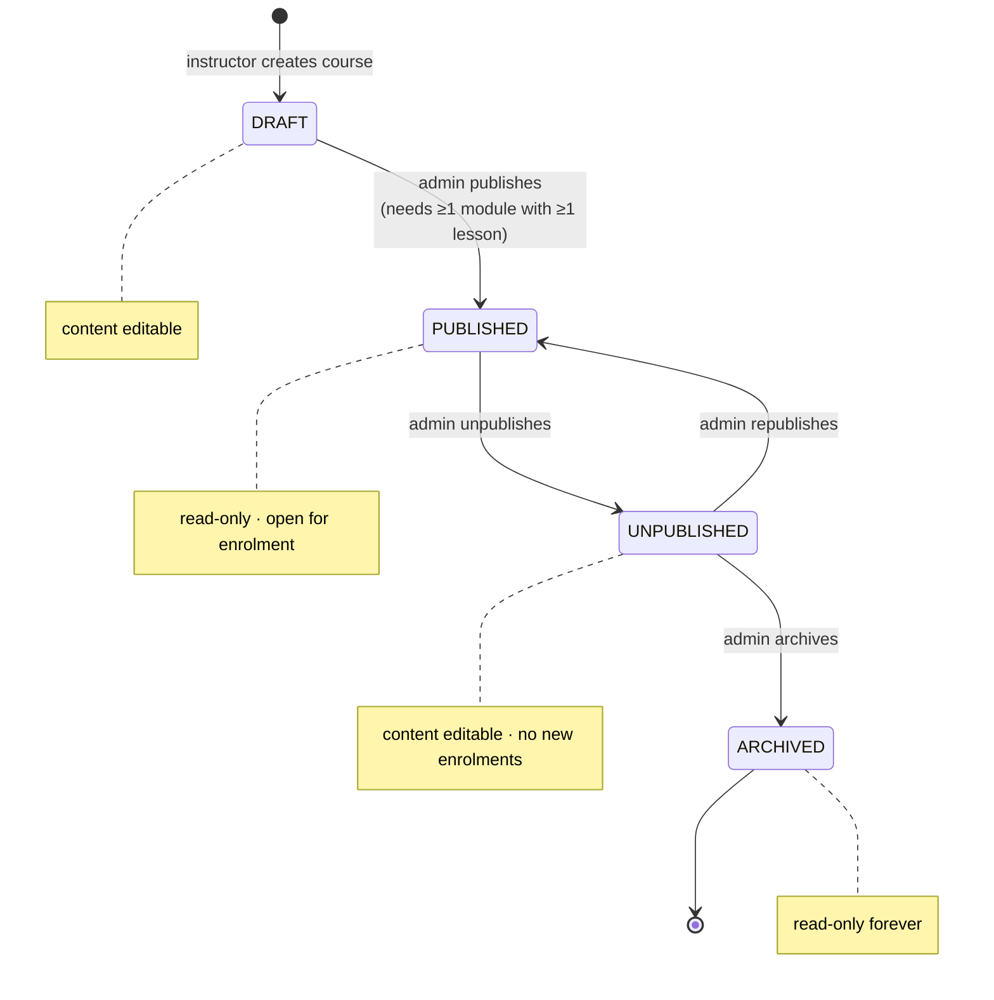
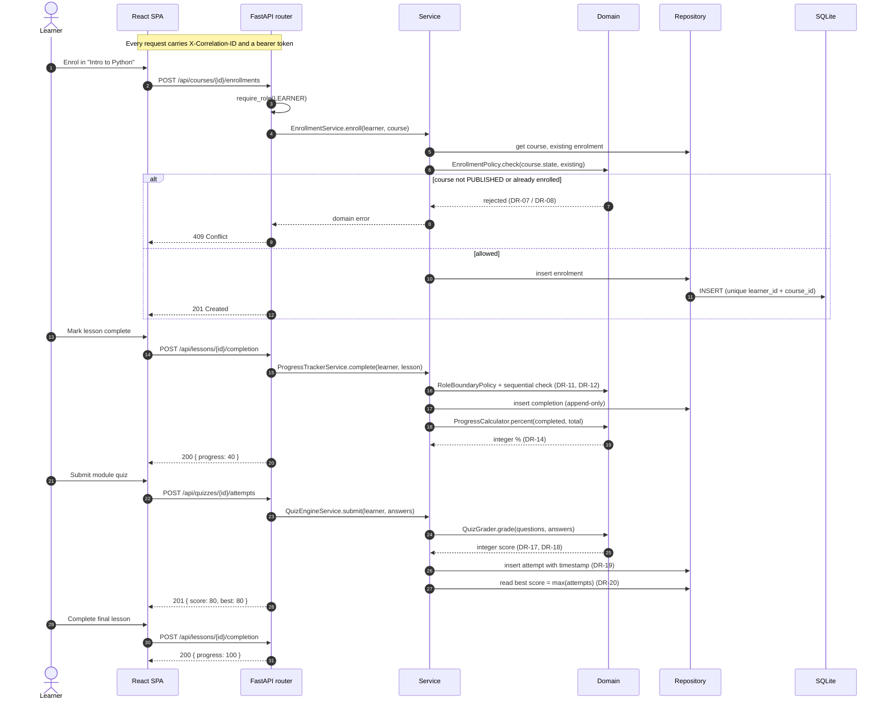
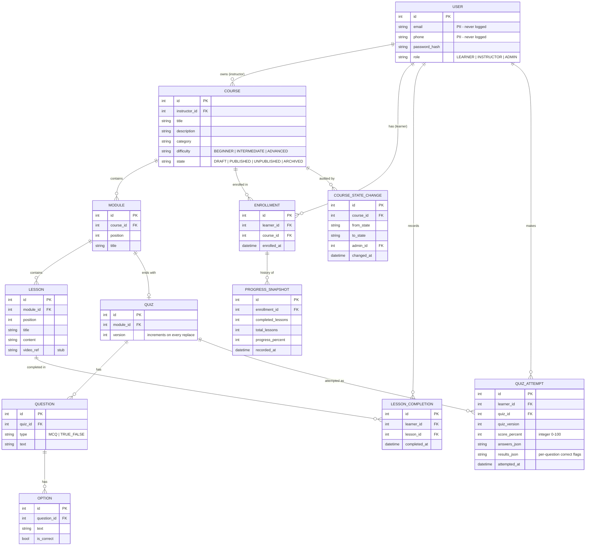
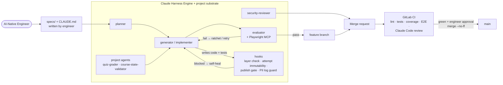

# LearnLab — Architecture

| Field | Value |
|---|---|
| Status | Draft — design baseline before development |
| Stack | FastAPI (Python 3.12) · React + TypeScript (Vite) · SQLite — see [tech-stack.md](tech-stack.md) |
| Rules source | [business-case.md](business-case.md) (DR-xx, AC-xx, NFR-xx) |

---

## 1. System context

Who uses LearnLab and what it talks to. External integrations are stubbed, as the brief requires.



## 2. Containers and runtime



**One-command start:** apply migrations → load seed data → start the API → serve the UI.

## 3. Backend layered architecture

The backend follows a strict four-layer structure. **Imports only go downward.** Services call **both** the domain layer and the repositories. The domain layer is pure Python with no framework, ORM or I/O imports, and never calls repositories. External integrations sit beside the repositories, behind interfaces.



### 3.1 Layer responsibilities

| Layer | Folder | Responsibility | Must not |
|---|---|---|---|
| Controllers | `api/` | HTTP routing, Pydantic request/response models, authentication and role checks (NFR-04), mapping domain exceptions to HTTP status codes | Contain business rules; touch repositories or the ORM directly |
| Services | `services/` | Use-case orchestration: load data via repositories, apply domain rules, persist results, enforce ownership | Import FastAPI; build HTTP responses |
| Repositories | `repositories/` | Data access via SQLAlchemy. Enrolment, completion and attempt repositories expose **insert and read only** (NFR-02) | Contain business rules; import services or controllers |
| Domain | `domain/` | Pure business rules and value objects: state machine, published-content guard, policies, integer-only grading and progress maths (NFR-01) | Import FastAPI, SQLAlchemy, logging or any other layer |
| Integrations | `integrations/` | Interfaces (`VideoProvider`, `PaymentProvider`) with stub implementations; swapped for real providers later without touching services | Make real network calls in this release |

### 3.2 Feature specs → services → domain

| Feature spec | Service | Main domain rules | ACs |
|---|---|---|---|
| `course-authoring_spec.md` | CourseAuthoringService | CourseStateMachine, PublishedContentGuard | AC-02, AC-03 |
| `catalog_spec.md` | CatalogService | CourseStateMachine | AC-04, AC-08, AC-10 |
| `enrollment_spec.md` | EnrollmentService | EnrollmentPolicy | AC-01 |
| `progress-tracker_spec.md` | ProgressTrackerService | ProgressCalculator | AC-07 |
| `quiz-engine_spec.md` | QuizEngineService | QuizGrader | AC-05, AC-06 |
| `instructor-workbench_spec.md` | AnalyticsService | ProgressCalculator, RoleBoundaryPolicy | AC-09, AC-10 |

RoleBoundaryPolicy is used by every service for ownership checks.

### 3.3 Architecture rules enforced as tests

| # | Rule | Enforced by |
|---|---|---|
| ARCH-01 | `api` → `services` → `repositories`; no upward imports | import-linter *layers* contract + harness `layers.js` hook + `tests/architecture/test_layering.py` |
| ARCH-02 | `domain` imports nothing from any other LearnLab package (`api`, `services`, `repositories`, `integrations`, `core`) and no third-party package — standard library only | import-linter *forbidden* contract + `tests/architecture/test_domain_purity.py` |
| ARCH-03 | `api` never imports `repositories` directly | import-linter *forbidden* contract |
| ARCH-04 | Every non-public route depends on an auth/role guard | `tests/architecture/test_route_guards.py` (inspects the FastAPI route table) |
| ARCH-05 | Insert-only repositories expose no update or delete methods | `tests/architecture/test_append_only_repos.py` |
| ARCH-06 | No `float`, true division `/` or `round(` in `QuizGrader` or `ProgressCalculator`; no SQL `AVG(` or `REAL` casts in repositories; every percentage field in a response model is `int` | `tests/architecture/test_no_float_math.py` (AST + model scan) |
| ARCH-07 | Services reach integrations only through the `VideoProvider` / `PaymentProvider` interfaces | import-linter *forbidden* contract (services may not import stub modules directly) |
| NFR-08 | Instructor cannot change own learners' grades; learner cannot read another learner's progress; published course cannot be mutated | `tests/architecture/test_nfr08_boundaries.py` |

## 4. Course lifecycle (AC-08)



Any transition not shown raises `InvalidCourseStateException`. The API maps it to **409 Conflict**.

`CourseStateMachine` owns the transitions. `PublishedContentGuard` owns the editing rule: any change to course details, modules, lessons or quiz questions is rejected unless the course is DRAFT or UNPUBLISHED (DR-05, NFR-08).

## 5. Enrolment-to-completion flow

The main learner journey, showing where each domain rule is applied.



## 6. Data model



**Integrity guarantees**

| Table | Constraint | Rule |
|---|---|---|
| `enrollment` | `UNIQUE (learner_id, course_id)`; insert-only | DR-08, DR-09 — no duplicates even under retries |
| `lesson_completion` | `UNIQUE (learner_id, lesson_id)`; insert-only | DR-13 |
| `quiz_attempt` | insert-only; `score_percent` is an `INTEGER` with a 0–100 check | DR-17, DR-19 |
| `module`, `lesson` | `UNIQUE (parent_id, position)` | Defines the order used by DR-12 |
| `course_state_change` | insert-only | Audit trail of every lifecycle transition (catalog_spec CL-5) |
| `progress_snapshot` | insert-only | History of progress after each new completion (progress-tracker_spec PR-12) |
| `course` | state changed only by conditional update `WHERE state = :from` | No double transitions under concurrency (catalog_spec CL-6) |

Best score and course progress are **computed** from these append-only tables rather than stored as mutable values. Snapshots are history, not the source of truth.

SQLite connections run in WAL mode with a 5-second busy timeout so concurrent writers wait rather than fail (enrollment_spec EN-3).

## 7. Cross-cutting concerns

| Concern | Design | Requirement |
|---|---|---|
| Authentication | Email + password login issues a role-scoped bearer token; `deps.py` guards decode it on every protected route | NFR-04 |
| Authorisation | Role checks in controllers; ownership checks (instructor owns course, learner owns record) in services via `RoleBoundaryPolicy` | DR-22 – DR-26, NFR-08 |
| External integrations | `VideoProvider` and `PaymentProvider` interfaces with stub implementations; video returns a placeholder reference, payment always reports "free course" | Brief §3.1, §6.3 |
| Logging | JSON log formatter; middleware creates or propagates `X-Correlation-ID` and adds it to every log line | NFR-06 |
| PII protection | Logging filter masks `email`, `phone`, `score`, `progress` keys; harness hook flags PII in log calls | NFR-03 |
| Errors | Domain exceptions → HTTP mapping in one exception handler (e.g. `InvalidCourseStateException` → 409, access denied → 403) | AC-08 |
| Migrations | Alembic; existing revision files are never edited (project hook blocks it) | NFR-05 |
| Health | `GET /health` returns 200 with no DB-heavy work | NFR-07 |

## 8. Repository layout (planned)

```text
learnlab/
├── CLAUDE.md                      # root rules (layered CLAUDE.md hierarchy)
├── AGENTS.md                      # table of contents only
├── plugin.json                    # project substrate plugin
├── .mcp.json                      # Playwright MCP
├── .claude/{agents,skills,commands,hooks}/
├── specs/                         # app_spec.md + per-feature specs, reviews/
├── sprint-contracts/
├── docs/                          # business-case, tech-stack, architecture, tdd, …
├── scripts/                       # Claude Agent SDK scripts
├── backend/
│   ├── CLAUDE.md
│   ├── src/learnlab/
│   │   ├── api/          CLAUDE.md
│   │   ├── services/     CLAUDE.md
│   │   ├── repositories/ CLAUDE.md
│   │   ├── domain/       CLAUDE.md
│   │   ├── integrations/ # VideoProvider, PaymentProvider + stubs
│   │   └── core/         # config, logging, security
│   ├── migrations/       # Alembic, append-only
│   └── tests/{unit,api,architecture}/
├── frontend/
│   ├── CLAUDE.md
│   ├── src/{pages,components,api}/
│   └── tests/            # Vitest
├── e2e/                           # Playwright tests + __snapshots__/
└── .gitlab-ci.yml
```

## 9. Delivery architecture (AI-native)

How the code gets built. No production code is written by hand.



## 10. Sprint sequence

Each sprint is one harness cycle (Generator → Evaluator → ratchet → merge request) and ends in at least one `--no-ff` merge to `main`. Sprint contracts go in `sprint-contracts/` and evaluator output in `specs/reviews/`.

| Sprint | Scope | ACs | Domain rules built |
|---|---|---|---|
| 0 — Foundation | Scaffold, layering + architecture tests, auth, health, logging middleware, CI pipeline | — (NFR-04, 05, 06, 07) | RoleBoundaryPolicy (skeleton) |
| 1 — Catalog + Enrolment | Course creation, lifecycle, publish/unpublish, catalog search, enrolment | AC-01, AC-02, AC-04, AC-08 | CourseStateMachine, PublishedContentGuard, EnrollmentPolicy |
| 2 — Modules, Lessons, Progress | Module/lesson authoring, sequential completion, progress %, progress bands | AC-03, AC-07, AC-09 | ProgressCalculator |
| 3 — Quiz Engine + Workbench | Quiz authoring and attempts, best score, instructor workbench, admin analytics | AC-05, AC-06, AC-10 | QuizGrader |

## 11. Component classification

Reviewed in Prompt 07 against the refined specs. Every component falls into exactly one class.

| Class | Components | Nature | Changes need |
|---|---|---|---|
| 1 · Deterministic domain rules | `domain/`: CourseStateMachine, PublishedContentGuard, EnrollmentPolicy, ProgressCalculator, QuizGrader, RoleBoundaryPolicy, domain exceptions | Pure functions, standard library only, integer maths, no I/O | A spec change (Spec-Is-Truth) |
| 2 · Application orchestration | `services/`: CourseAuthoring, Catalog, Enrollment, ProgressTracker, QuizEngine, Analytics | Load → apply domain rule → persist in one transaction; ownership checks | A spec or story change |
| 3 · Infrastructure | `repositories/`, ORM models, SQLite (WAL, busy timeout), Alembic migrations, `integrations/` stubs, `core/clock.py` | Data access and adapters; insert-only for append-only tables | Architecture review for schema changes; new migration only |
| 4 · Interface | `api/` FastAPI routers + Pydantic models; React SPA (`frontend/`) | Validation, role guards, error mapping, presentation | A spec change for any new endpoint or field |
| 5 · Security controls | JWT auth (`core/security.py`), `require_role` guards, RoleBoundaryPolicy ownership checks, validation handler that never echoes input, Markdown rendered without raw HTML, `video_ref` https-only, `LIKE` escaping | Deterministic, enforced at the controller boundary and in services | Security review (`security-reviewer`) |
| 6 · Observability | JSON log formatter, correlation-ID middleware, PII redaction filter, `/health` | Cross-cutting middleware; never logs bodies or PII | — |
| 7 · Delivery harness | Claude Harness Engine agents and hooks, LearnLab project agents / skills / commands / hooks, tests, import-linter, GitLab CI, protected `main` | Build-time only; the only place AI is used | Engineer approval |

**No runtime AI.** Classes 1–6 make up the running application and contain no model calls. Class 7 generates and verifies them.

**Two architecture documents.** The harness planner writes its own `specs/design/architecture.md` during `/brd` → `/spec` → `/design`. That file must stay consistent with this one; when they differ, this document and the specs win (Spec-Is-Truth) and the planner output is regenerated.

## 12. Rule enforcement map

Where each rule is enforced, from earliest (while the agent writes) to latest (human review). Test paths are under `backend/tests/`. CI job names match `docs/test-strategy.md` §8.

| Rule | Hook | Unit / API test | Architecture test | CI job | Human review |
|---|---|---|---|---|---|
| ARCH-01 layers only import downward | harness `layers.js` (via `project-manifest.json`) | — | `test_layering.py` + import-linter `layers` | `lint`, `test-backend` | MR |
| ARCH-02 domain purity | harness `layers.js` | — | `test_domain_purity.py` + import-linter `forbidden` | `test-backend` | MR |
| ARCH-03 api never imports repositories | harness `layers.js` | — | import-linter `forbidden` | `lint` | MR |
| ARCH-04 every route guarded | — | role tests in each `api/test_*_api.py` | `test_route_guards.py` | `test-backend` | `security-reviewer` |
| ARCH-05 insert-only repositories | `attempt-immutability-check` | — | `test_append_only_repos.py` | `test-backend` | MR |
| ARCH-06 integer maths only | — | `test_quiz_grader.py`, `test_progress_calculator.py` | `test_no_float_math.py` | `test-backend` | `quiz-grader-agent` |
| ARCH-07 integrations via interfaces | — | — | import-linter `forbidden` | `lint` | MR |
| NFR-01 integer scores and progress | — | golden-case tests | `test_no_float_math.py` | `test-backend` | `quiz-grader-agent` |
| NFR-02 append-only records | `attempt-immutability-check` | concurrency tests | `test_append_only_repos.py` | `test-backend` | MR |
| NFR-03 no PII in logs or errors | `pii-log-guard` | `unit/core/test_log_redaction.py`, `api/test_error_format.py` | — | `test-backend` | `security-reviewer` |
| NFR-04 auth at controller layer | — | role tests per endpoint | `test_route_guards.py` | `test-backend` | `security-reviewer` |
| NFR-05 append-only migrations | `attempt-immutability-check` | — | — | `migrations-append-only` | MR |
| NFR-06 JSON logs + correlation id | — | `api/test_correlation_id.py` | — | `test-backend` | — |
| NFR-07 health within 1 s | — | `api/test_health.py` | — | `test-backend`, `smoke-start` | — |
| NFR-08 role and content boundaries | `course-publish-gate` | AC-03.3, AC-07.9 API tests | `test_nfr08_boundaries.py` | `test-backend` | `course-state-validator-agent` |
| NFR-09 one-command start | — | — | — | `smoke-start` | Evaluator starts the app |
| NFR-10 synthetic data only | harness secret scan | `unit/test_synthetic_data.py` | — | `test-backend`, gitleaks | MR |
| NFR-11 coverage thresholds | — | — | — | `test-backend` (`--cov-fail-under`) | MR |
| Every AC has a tagged test | — | — | — | `ac-audit` (`scripts/ac_audit.py`) | `/ac-coverage` command |
| PR-only merge to `main` | harness `pre-bash-gate` | — | — | protected branch | Engineer approves every MR |
