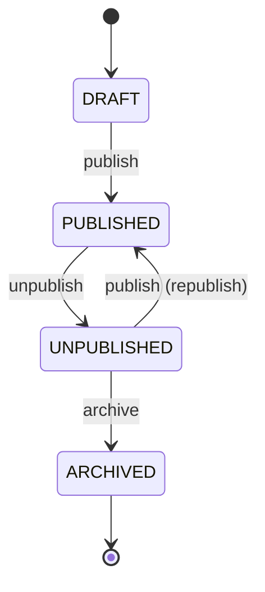

# Feature Spec: Catalog & Course Lifecycle

| Field | Value |
|---|---|
| Spec ID | CATALOG |
| Parent | [app_spec.md](app_spec.md) |
| Requirements | FR-12 – FR-18 |
| Acceptance criteria | AC-04, AC-08, AC-10 (catalog management part) |
| Domain rules | DR-02 – DR-04, DR-06 (business-case §5.1) |
| Service | `CatalogService` |
| Domain files | `CourseStateMachine`, `RoleBoundaryPolicy` |
| Sprint | 1 |

## 1. Purpose

Give learners a searchable catalog of live courses, and give admins full control over which courses are live. The course lifecycle is a strict state machine; any move it doesn't allow is rejected.

## 2. Actors and permissions

| Action | Learner | Instructor | Admin |
|---|---|---|---|
| Browse / search PUBLISHED courses | ✅ | ✅ | ✅ |
| View PUBLISHED course outline | ✅ | ✅ | ✅ |
| List all courses in any state | 403 | 403 (own only, via authoring) | ✅ |
| Publish / unpublish / archive | 403 | 403 | ✅ |

## 3. Business rules

### 3.1 Lifecycle state machine (`CourseStateMachine`)



Full transition table — every cell not marked ✅ raises `InvalidCourseStateException`:

| From \ Action | publish | unpublish | archive |
|---|---|---|---|
| DRAFT | ✅ → PUBLISHED | ❌ | ❌ |
| PUBLISHED | ❌ | ✅ → UNPUBLISHED | ❌ |
| UNPUBLISHED | ✅ → PUBLISHED | ❌ | ✅ → ARCHIVED |
| ARCHIVED | ❌ | ❌ | ❌ |

| ID | Rule | Source |
|---|---|---|
| CL-1 | `CourseStateMachine.transition(state, action)` is a pure function returning the new state or raising `InvalidCourseStateException(from_state, action)`. | DR-02, DR-03 |
| CL-2 | The API maps `InvalidCourseStateException` to 409 `INVALID_COURSE_STATE`; the stored state is unchanged. | DR-03 |
| CL-3 | Publishing requires at least one module containing at least one lesson; otherwise 409 `COURSE_NOT_READY`. | DR-06 |
| CL-4 | Only admins may trigger transitions. | DR-04 |
| CL-5 | Each successful transition is written to an append-only `course_state_change` record (course, from, to, admin, timestamp) for audit. | — |
| CL-6 | The state change is a conditional update (`UPDATE … SET state = :to WHERE id = :id AND state = :from`). If no row is updated because another request changed the state first, the request returns 409 `INVALID_COURSE_STATE` and writes no audit record. | spec-review R-13 |

### 3.2 Catalog

| ID | Rule |
|---|---|
| CT-1 | The catalog returns only PUBLISHED courses. |
| CT-2 | Filters: `category` (exact, case-insensitive), `difficulty` (exact), `q` (case-insensitive substring of title, at most 100 characters; `%` and `_` are escaped so they match literally). Filters combine with AND. |
| CT-3 | Results are sorted by title A–Z. Paging: `page` (default 1) and `page_size` (default 20, max 100). |
| CT-4 | Requesting the outline of a course that is not PUBLISHED via the catalog returns 404 (it is not public). |
| CT-5 | Each catalog item includes `module_count`, `lesson_count` and, for learners, `is_enrolled`. |

## 4. API contract

| Method | Path | Role | Request | Success | Errors |
|---|---|---|---|---|---|
| GET | `/api/catalog/courses` | any authenticated | `?category&difficulty&q&page&page_size` | 200 `{items: CatalogItem[], total, page, page_size}` | 422 |
| GET | `/api/catalog/courses/{course_id}` | any authenticated | — | 200 `CourseOutline` (no lesson content) | 404 |
| GET | `/api/catalog/categories` | any authenticated | — | 200 `string[]` (categories with ≥1 PUBLISHED course) | — |
| GET | `/api/admin/courses` | ADMIN | `?state` | 200 `AdminCourse[]` | 403, 422 |
| POST | `/api/admin/courses/{course_id}/publish` | ADMIN | — | 200 `Course` | 403, 404, 409 `INVALID_COURSE_STATE` / `COURSE_NOT_READY` |
| POST | `/api/admin/courses/{course_id}/unpublish` | ADMIN | — | 200 `Course` | 403, 404, 409 `INVALID_COURSE_STATE` |
| POST | `/api/admin/courses/{course_id}/archive` | ADMIN | — | 200 `Course` | 403, 404, 409 `INVALID_COURSE_STATE` |

```text
CatalogItem  { id, title, description, category, difficulty, instructor_name, module_count, lesson_count, is_enrolled }
AdminCourse  { ...Course, instructor_name, module_count, lesson_count, enrollment_count, ready_to_publish }
```

`ready_to_publish` is true when the course is DRAFT or UNPUBLISHED and meets CL-3.

## 5. UI

- **Catalog page:** search box, category and difficulty filters, course cards in a responsive grid (1 column at 375 px, 3 columns at 1280 px). Each card shows an "Enrolled" badge or an "Enrol" button.
- **Course detail page:** description, outline of modules and lesson titles, "Enrol" button.
- **Admin Console → Courses:** table of all courses with a state filter, state badge, "ready to publish" indicator and action buttons that are enabled only for transitions allowed from the current state.

## 6. Acceptance criteria

### AC-04 — Admin publishes and unpublishes; enrolment only in PUBLISHED

**AC-04.1 Publish a ready draft**
- **Given** a DRAFT course with 1 module containing 2 lessons
- **When** an admin calls `POST /api/admin/courses/{id}/publish`
- **Then** the response is 200, `state` is `"PUBLISHED"` and the course appears in `GET /api/catalog/courses`

**AC-04.2 Cannot publish an empty course**
- **Given** a DRAFT course with no lessons
- **When** an admin publishes it
- **Then** the response is 409 `COURSE_NOT_READY` and the state is still `"DRAFT"`

**AC-04.3 Unpublish removes from catalog**
- **Given** a PUBLISHED course
- **When** an admin calls `POST /api/admin/courses/{id}/unpublish`
- **Then** the response is 200, `state` is `"UNPUBLISHED"`, the course is absent from the catalog and `GET /api/catalog/courses/{id}` returns 404

**AC-04.4 Only admins change state**
- **Given** an instructor who owns a DRAFT course, or a learner
- **When** they call the publish endpoint for it
- **Then** the response is 403 and the state is unchanged

**AC-04.5 Enrolment only in PUBLISHED** (verified with enrollment_spec AC-01.4)
- **Given** a course that is DRAFT, UNPUBLISHED or ARCHIVED
- **When** a learner tries to enrol
- **Then** the response is 409 `COURSE_NOT_PUBLISHED`

### AC-08 — Lifecycle enforced; invalid transitions raise `InvalidCourseStateException`

**AC-08.1 Every allowed transition succeeds** (parametrised over the 4 ✅ cells)
- **Given** a course in the "from" state that meets CL-3
- **When** the matching action is applied
- **Then** the new state equals the "to" state in the transition table

**AC-08.2 Every forbidden transition raises** (parametrised over the 8 ❌ cells)
- **Given** a course in the "from" state
- **When** a forbidden action is applied to `CourseStateMachine`
- **Then** `InvalidCourseStateException` is raised, naming the from-state and the action

**AC-08.3 API maps the exception to 409**
- **Given** a DRAFT course
- **When** an admin calls `POST /api/admin/courses/{id}/archive`
- **Then** the response is 409 `INVALID_COURSE_STATE` and the course is still `"DRAFT"`

**AC-08.4 Archived is final**
- **Given** an ARCHIVED course
- **When** an admin publishes, unpublishes or archives it
- **Then** each response is 409 `INVALID_COURSE_STATE`

**AC-08.5 Transitions are audited**
- **Given** a DRAFT course
- **When** an admin publishes and then unpublishes it
- **Then** two `course_state_change` records exist: DRAFT→PUBLISHED and PUBLISHED→UNPUBLISHED, each with the admin's ID and a timestamp

**AC-08.6 Concurrent transitions apply once**
- **Given** a ready DRAFT course
- **When** two publish requests are sent concurrently
- **Then** exactly one returns 200, the other returns 409 `INVALID_COURSE_STATE`, and exactly one DRAFT→PUBLISHED audit record exists

**CT-AC.3 Wildcards are literal**
- **Given** the seeded PUBLISHED courses, none with `%` in the title
- **When** a learner searches `q=%`
- **Then** no courses are returned

### AC-10 (catalog part) — Admin manages the catalog and approves courses

**AC-10.1 Admin sees all states**
- **Given** seeded courses in DRAFT, PUBLISHED and UNPUBLISHED
- **When** an admin calls `GET /api/admin/courses`
- **Then** all courses are listed with their state, and `?state=DRAFT` returns only DRAFT courses

**AC-10.2 Ready-to-publish indicator**
- **Given** one DRAFT course with lessons and one without
- **When** an admin lists DRAFT courses
- **Then** `ready_to_publish` is true for the first and false for the second

**AC-10.3 Non-admins cannot list all courses**
- **Given** a learner or instructor
- **When** they call `GET /api/admin/courses`
- **Then** the response is 403

### Catalog browsing (supports AC-01, AC-10)

**CT-AC.1 Filter by category and difficulty**
- **Given** PUBLISHED courses "Intro to Python" (Programming, BEGINNER) and "Advanced SQL" (Data, ADVANCED), and a DRAFT course "Rust Basics" (Programming, BEGINNER)
- **When** a learner calls `GET /api/catalog/courses?category=programming&difficulty=BEGINNER`
- **Then** only "Intro to Python" is returned

**CT-AC.2 Keyword search**
- **Given** the same courses
- **When** a learner searches `q=sql`
- **Then** only "Advanced SQL" is returned

## 7. Non-functional

- NFR-04: admin routes use `require_role(ADMIN)`.
- NFR-02: `course_state_change` is insert-only.

## 8. Out of scope

- Full-text search, ratings, recommendations.
- Scheduled publishing; instructor "submit for review" workflow (an admin publishing *is* the approval — A-5).

## 9. Test traceability

| Test file | Covers |
|---|---|
| `backend/tests/unit/domain/test_course_state_machine.py` | CL-1 · AC-08.1, AC-08.2, AC-08.4 (parametrised over the full table) |
| `backend/tests/unit/services/test_catalog_service.py` | CL-3, CT-1 – CT-3 · AC-04.2, CT-AC.1, CT-AC.2 |
| `backend/tests/api/test_admin_lifecycle_api.py` | AC-04.1 – AC-04.4, AC-08.3, AC-08.5, AC-10.1 – AC-10.3 |
| `backend/tests/api/test_lifecycle_concurrency.py` | CL-6 · AC-08.6 |
| `backend/tests/api/test_catalog_api.py` | CT-1 – CT-5 · AC-04.3, CT-AC.1 – CT-AC.3 |
| `e2e/catalog.spec.ts` | Catalog filter + course detail at 375 px and 1280 px |
| `e2e/admin-console.spec.ts` | Publish / unpublish from the admin console |
